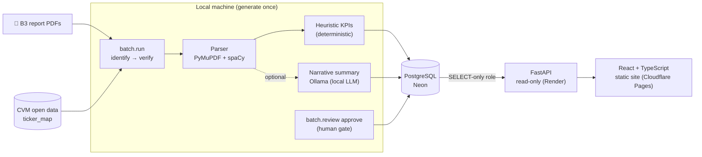

# Finance Data Platform

[](https://github.com/allvaret/Document_Parsing_Pipeline/actions/workflows/tests.yml)


**English** · [Português](README.pt-BR.md)

Finance Data Platform extracts and summarizes quarterly reports from companies listed on
the Brazilian stock exchange (B3). The PDFs are processed **once, offline**: a layout-aware
parser rebuilds sections and tables, a **deterministic heuristic** extracts the key
indicators, and an optional **local LLM** writes only the narrative. A person reviews every
report before a **read-only API** and a React site publish it.

**Live site:** [document-parsing-pipeline.pages.dev](https://document-parsing-pipeline.pages.dev/)


---

## Why

Earnings releases run 30 to 80 pages, and each company lays them out differently. Asking an
LLM to read the raw PDF loses the structure (headings, tables, the page a number came from),
and it lets a model rewrite numbers that investors will act on. This project splits the work
in two. Code reads the document and pulls out the numbers deterministically. The LLM is only
allowed to write prose.

## Architecture



| Layer | Path | Responsibility |
|---|---|---|
| Parser and summarizer | `src/resumo/` | PDF → sections → heuristic keypoints + summary; LLM providers |
| Batch | `src/batch/` | Identifies company, type and period; idempotent writes; review CLI |
| Company registry | `src/data_pipeline/` | CVM registry (CNPJ, tickers, aliases), fuzzy search |
| Database | `src/db/`, `migrations/` | SQLAlchemy models, repository, read queries, Alembic |
| API | `src/site_backend/` | Read-only FastAPI + price-ceiling calculator |
| Site | `src/site_frontend/` | React 19 + Vite + TypeScript + Tailwind |

## Engineering decisions

| Decision | Why |
|---|---|
| **Generate once.** A local batch produces the summaries and stores them. No endpoint calls an LLM. | Predictable cost and latency. The site runs on free hosting with no GPU. |
| **Numbers never go through the LLM.** Keypoints always come from the heuristic. | An LLM can quietly change a number. Deterministic extraction can be tested. |
| **Idempotent by schema.** Reports are unique by file hash and by (company, type, period). Summaries are unique by (report, method, model, prompt version). | Running the batch twice never duplicates anything. The database enforces it, not just the application code. |
| **Explicit versions decide what to regenerate.** `extractor_version` governs keypoints and `prompt_version` governs summaries. | Changing a prompt regenerates only the summaries. The skip check runs before the PDF is opened. |
| **No silent failure.** Errors are typed exceptions (`LLMError`, `SchemaOutdatedError`, …), with no fallback that doesn't warn. | An error string stored as data in a financial product is worse than a crash. |
| **Human review gate.** Only reports with `reviewed_at` are public. If the numbers change, the approval is revoked. | Heuristics make mistakes. Publishing is a decision a person makes. |
| **Read-only in depth.** The API uses a SELECT-only database role and read-only sessions, and tests assert that only `SELECT` is ever emitted. | The public surface cannot write, even if it has a bug. |
| **The registry decides, the PDF confirms.** The company is resolved from CVM data (CNPJ → ticker → normalized name). The text on the cover only cross-checks it. | Cover-page detection got real PDFs wrong. Official data is the source of truth. |

## Highlights

- **Layout-aware PDF parser**: titles detected by font size and position, spaCy semantic scoring, and reconstruction of tables and sections.
- **Pluggable LLM provider** (local Ollama behind a `Protocol`): typed errors, retries on transient failures, and detection of prompts truncated by the context window.
- **Batch you can operate**: file lock, JSONL logs, exit codes `0/1/2`, `--dry-run`, and a cheap skip based on hash and versions.
- **Hardened API**: strict CORS and trusted hosts, security headers and CSP, per-IP rate limiting, input validation, and docs disabled by default.
- **SQL injection safety net**: only SQLAlchemy expressions with bound parameters, canary tests, and a lint that rejects raw SQL in `src/db` and `src/site_backend`.
- **End-to-end typed contract**: Pydantic schemas → committed OpenAPI → generated TypeScript types. Tests fail on drift in both directions.
- **Safe rendering of LLM output**: a custom Markdown renderer builds React elements (no raw HTML), under a strict CSP pinned to the exact API origin at build time.
- **Schema safety net**: ORM/SQL parity tests and Alembic migrations compared against the models on PostgreSQL in CI.
- **Accessible UI**: ARIA live regions, a labeled combobox search, and color-contrast tests.
- **Price-ceiling calculator** (Graham number, Graham formula, Bazin, Gordon DDM, REIT yield vs. NTN-B) built with Strategy/Factory.

## Measured results

| What | Before | After |
|---|---|---|
| Pre-filter for event documents (by file name, before parsing) | 68 s / file | **0.04 s / file** |
| Re-running an already stored PDF (skip by hash + versions) | 6–10 s | **0.1–0.5 s** |
| Tickers mapped (manual list → CVM FCA official data) | 499 | **809** |
| Tests | — | **846 backend** (SQLite + PostgreSQL in CI) + **92 frontend** |

## Running locally

### Full stack with Docker

```bash
cp .env.example .env          # set POSTGRES_PASSWORD and READONLY_POSTGRES_PASSWORD
docker compose up --build     # db → read-only role → migrations → api → web
```

- Site: http://localhost:8080
- API: http://localhost:8000. Docs are at `/docs`, enabled locally only.

The database starts empty. Fill it with the batch, or restore a dump with `scripts/dump_banco.sh`.

### Backend and batch (Python 3.11+)

```bash
pip install -e ".[dev]"
python -m spacy download pt_core_news_md

# generate the company registry from CVM open data
python -m data_pipeline.ticker_registry

# process a folder of PDFs (heuristic only, or with the local LLM)
python -m batch.run --dir <folder> --mode heuristic
python -m batch.run --dir <folder> --mode llm          # requires `ollama serve`

# review and publish
python -m batch.review list --pending
python -m batch.review show <report_id>
python -m batch.review approve <report_id>

# API
uvicorn site_backend.main:app --reload
```

Without `DATABASE_URL`, the project uses SQLite at `data/app.db`. To use PostgreSQL, set
`DATABASE_URL` and run `alembic upgrade head` first.

### Frontend

```bash
cd src/site_frontend
npm ci && npm run dev                       # dev server
VITE_API_URL=https://<api> npm run build    # production build fails without VITE_API_URL
```

## Tests and quality

```bash
pytest                    # full suite (integration tests need the sample PDF + spaCy model)
pytest -m "not integration"
```

- Tests never touch `data/app.db`. Each test gets its own database, and `conftest.py` fails the suite if the real database is created or changed.
- CI runs the suite against SQLite **and** PostgreSQL 17, and checks that the migrations match the models.
- Frontend: `npm run lint`, `tsc -b`, and `npm test` (Vitest + Testing Library).

## Deployment

| Piece | Host | Notes |
|---|---|---|
| Database | Neon (PostgreSQL) | Two URLs: the owner URL for migrations and the batch, `finance_ro` (SELECT only) for the API |
| API | Render (Docker) | Non-root `python:3.11-slim` image with API dependencies only; `/health` check |
| Site | Cloudflare Pages | Static build. `VITE_API_URL` is fixed at build time and written into the CSP |

The batch still runs on the developer's machine against the production database. The public side only reads.

## Known limitations

- Some keypoints come out with value and variation swapped. This is a limitation of the heuristic, and it will be addressed with mass testing over real PDFs rather than by hiding the keypoint.
- Real estate funds (FIIs) are not supported yet.
- The heuristic was tuned on a limited set of real reports, so new layouts may need adjustments.
- The free API tier sleeps after 15 minutes of inactivity, so the first request can take about a minute.

## Roadmap

- Mass testing of keypoints on real reports
- Company aliases in the database and better search
- FII support
- Frontend and Docker image builds in CI

## License

[MIT](LICENSE) © 2026 Alvaro Danko
