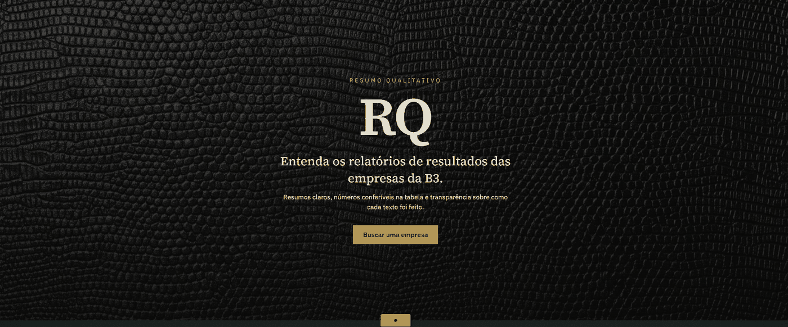
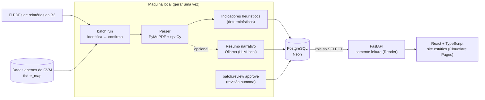

# Finance Data Platform

[](https://github.com/allvaret/Document_Parsing_Pipeline/actions/workflows/tests.yml)


[English](README.md) · **Português**

A Finance Data Platform extrai e resume relatórios trimestrais de empresas da B3. Os PDFs são
processados **uma única vez, offline**. Um parser sensível a layout reconstrói seções e tabelas,
uma **heurística determinística** extrai os indicadores e um **LLM local** opcional escreve só a
narrativa. Todo relatório passa por revisão humana antes de ser publicado por uma **API somente
leitura** e um site React.

**Site:** <SITE_URL>



---

## Por quê

Releases de resultado têm de 30 a 80 páginas, e cada empresa usa um layout diferente. Mandar o
PDF cru para um LLM tem dois problemas:

- Perde a estrutura: títulos, tabelas e a página de onde veio cada número.
- Deixa o modelo reescrever números que o investidor vai usar para decidir.

Por isso o projeto separa o trabalho. O código lê o documento e extrai os números de forma
determinística. O LLM só escreve texto.

## Arquitetura



| Camada | Caminho | Responsabilidade |
|---|---|---|
| Parser e resumo | `src/resumo/` | PDF → seções → keypoints heurísticos + resumo; provedores de LLM |
| Batch | `src/batch/` | Identifica empresa, tipo e período; grava de forma idempotente; CLI de revisão |
| Cadastro de empresas | `src/data_pipeline/` | Registro da CVM (CNPJ, tickers, aliases), busca fuzzy |
| Banco | `src/db/`, `migrations/` | Modelos SQLAlchemy, repositório, consultas de leitura, Alembic |
| API | `src/site_backend/` | FastAPI somente leitura + calculadora de preço teto |
| Site | `src/site_frontend/` | React 19 + Vite + TypeScript + Tailwind |

## Decisões de engenharia

| Decisão | Por quê |
|---|---|
| **Gerar uma vez.** Um batch local gera os resumos e os grava no banco. Nenhum endpoint chama LLM. | Custo e latência previsíveis. O site roda em hospedagem gratuita, sem GPU. |
| **Número nunca passa pelo LLM.** Os keypoints sempre vêm da heurística. | Um LLM pode alterar um número sem avisar. Extração determinística dá para testar. |
| **Idempotente pelo schema.** Relatório é único por hash do arquivo e por (empresa, tipo, período). Resumo é único por (relatório, método, modelo, versão do prompt). | Rodar o batch duas vezes não duplica nada. Quem garante é o banco, não só o código. |
| **Versões explícitas decidem o que regerar.** `extractor_version` governa os keypoints e `prompt_version` governa os resumos. | Mudar o prompt regera só os resumos. A decisão de pular acontece antes de abrir o PDF. |
| **Sem falha silenciosa.** Erros viram exceções tipadas (`LLMError`, `SchemaOutdatedError`, …), e nenhum fallback acontece sem aviso. | Num produto financeiro, uma string de erro gravada como dado é pior que um crash. |
| **Revisão humana antes de publicar.** Só relatórios com `reviewed_at` aparecem no site. Se os números mudam, a aprovação cai. | Heurísticas erram. Publicar é decisão de uma pessoa. |
| **Somente leitura em camadas.** A API usa role do banco que só faz SELECT e sessões somente leitura, e os testes garantem que só sai `SELECT`. | A parte pública não consegue escrever no banco, nem com bug. |
| **O cadastro decide, o PDF confirma.** A empresa vem dos dados da CVM (CNPJ → ticker → nome normalizado). O texto da capa só serve para conferir. | Achar a empresa pela capa errou em PDFs reais. A fonte da verdade é o dado oficial. |

## Destaques

- **Parser de PDF sensível a layout.** Detecta títulos por tamanho de fonte e posição, pontua semanticamente com spaCy e reconstrói tabelas e seções.
- **Provedor de LLM plugável.** O Ollama local fica atrás de um `Protocol`, com erros tipados, retry em falhas transitórias e detecção de prompt cortado pela janela de contexto.
- **Batch fácil de operar.** Tem lock, log JSONL, códigos de saída `0/1/2` e `--dry-run`, e pula o que já foi gravado com uma checagem barata de hash e versões.
- **API endurecida.**
  - CORS e hosts restritos.
  - Headers de segurança e CSP.
  - Limite de requisições por IP.
  - Validação de entrada.
  - Docs desligadas por padrão.
- **Proteção contra SQL injection.** Só expressões do SQLAlchemy com parâmetros ligados, testes com canário e um lint que barra SQL cru em `src/db` e `src/site_backend`.
- **Contrato tipado de ponta a ponta.** Schemas Pydantic geram o OpenAPI commitado, que gera os tipos TypeScript. Testes acusam divergência dos dois lados.
- **Saída do LLM renderizada com segurança.** Um Markdown próprio monta elementos React, sem HTML cru. A CSP é rígida e fica presa à origem exata da API no build.
- **Proteção do schema.** Testes de paridade entre ORM e SQL, e as migrações Alembic são comparadas com os modelos em PostgreSQL no CI.
- **Interface acessível.** Regiões ARIA live, busca em combobox com rótulo e testes de contraste.
- **Calculadora de preço teto.** Número de Graham, fórmula de Graham, Bazin, Gordon e yield de FII vs. NTN-B, em Strategy/Factory.

## Resultados medidos

| O quê | Antes | Depois |
|---|---|---|
| Pré-filtro de documentos de evento (pelo nome, antes de parsear) | 68 s / arquivo | **0,04 s / arquivo** |
| Reprocessar um PDF já gravado (SKIP por hash + versões) | 6–10 s | **0,1–0,5 s** |
| Tickers mapeados (lista manual → FCA oficial da CVM) | 499 | **809** |
| Testes | — | **846 no backend** (SQLite + PostgreSQL no CI) + **92 no frontend** |

## Como rodar

### Tudo com Docker

```bash
cp .env.example .env          # defina POSTGRES_PASSWORD e READONLY_POSTGRES_PASSWORD
docker compose up --build     # banco → role somente leitura → migrações → api → site
```

O site fica em http://localhost:8080 e a API em http://localhost:8000. As docs ficam em `/docs` e só vêm ligadas localmente.

O banco começa vazio. Para preencher, rode o batch ou restaure um dump com `scripts/dump_banco.sh`.

### Backend e batch (Python 3.11+)

```bash
pip install -e ".[dev]"
python -m spacy download pt_core_news_md

# gera o cadastro de empresas a partir dos dados abertos da CVM
python -m data_pipeline.ticker_registry

# processa uma pasta de PDFs (só heurística, ou com o LLM local)
python -m batch.run --dir <pasta> --mode heuristic
python -m batch.run --dir <pasta> --mode llm          # requer `ollama serve`

# revisa e publica
python -m batch.review list --pending
python -m batch.review show <id>
python -m batch.review approve <id>

# API
uvicorn site_backend.main:app --reload
```

Sem `DATABASE_URL`, o projeto usa SQLite em `data/app.db`. Para usar PostgreSQL, defina
`DATABASE_URL` e rode `alembic upgrade head` antes.

### Frontend

```bash
cd src/site_frontend
npm ci && npm run dev                       # servidor de desenvolvimento
VITE_API_URL=https://<api> npm run build    # o build de produção falha sem VITE_API_URL
```

## Testes e qualidade

```bash
pytest                    # suíte completa (integração precisa do PDF de exemplo + modelo spaCy)
pytest -m "not integration"
```

- Os testes nunca tocam `data/app.db`. Cada teste tem um banco próprio, e o `conftest.py` derruba a suíte se o banco real for criado ou alterado.
- O CI roda a suíte em SQLite **e** em PostgreSQL 17, e confere se as migrações batem com os modelos.
- No frontend: `npm run lint`, `tsc -b` e `npm test` (Vitest + Testing Library).

## Deploy

| Peça | Onde | Observações |
|---|---|---|
| Banco | Neon (PostgreSQL) | Duas URLs: a do dono, para migrações e batch, e a do `finance_ro` (só SELECT), para a API |
| API | Render (Docker) | Imagem `python:3.11-slim` sem root e só com as dependências da API; health check em `/health` |
| Site | Cloudflare Pages | Build estático. `VITE_API_URL` é fixado no build e gravado na CSP |

O batch continua rodando na máquina do desenvolvedor, apontando para o banco de produção. A parte pública só lê.

## Limitações conhecidas

- Alguns keypoints saem com valor e variação trocados. É uma limitação da heurística e vai ser tratada com testes em massa nos PDFs reais, sem esconder o keypoint.
- Fundos imobiliários (FIIs) ainda não são suportados.
- A heurística foi ajustada num conjunto limitado de relatórios reais, então layouts novos podem pedir ajuste.
- A API no plano gratuito dorme depois de 15 minutos parada, e a primeira requisição pode levar cerca de um minuto.

## Próximos passos

- Testes em massa dos keypoints com relatórios reais
- Aliases de empresa no banco e busca melhor
- Suporte a FIIs
- Build do frontend e das imagens Docker no CI

## Licença

[MIT](LICENSE) © 2026 Alvaro Danko
